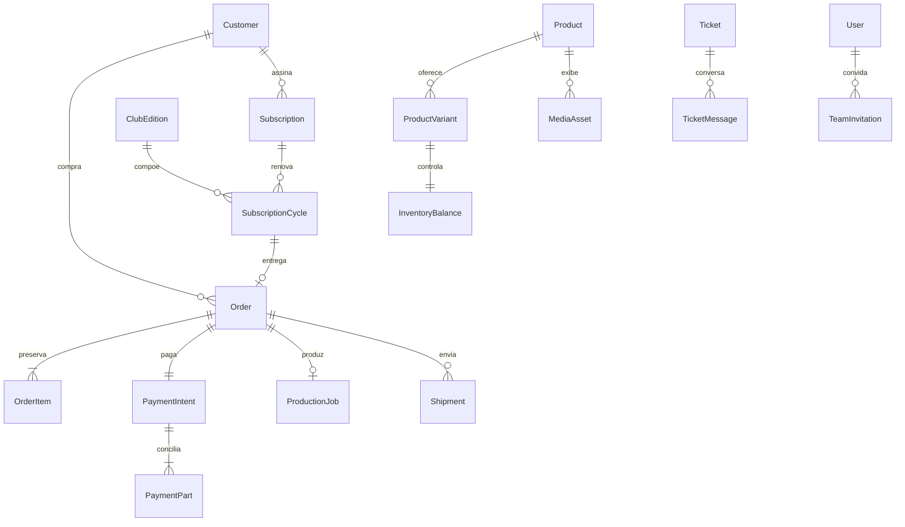

# Backend Mãos em Oração — plano de implementação

> Atualização de 10/11/2026: API, worker, banco e integrações foram implementados. O estado atual, os comandos, os limites e o deploy estão no [runbook do backend](BACKEND-RUNBOOK.md). As seções de planejamento abaixo preservam a especificação anterior; não são um registro de implantação em provedores.

Decisões confirmadas em 09/11/2026: NestJS modular, Prisma, PostgreSQL, Redis, Railway; Bunny Storage para imagens e arquivos de fabricação; Bunny Stream e YouTube para vídeos; Melhor Envio para frete; Mercado Pago para checkout transparente Pix/cartão e assinatura do clube; Resend para e-mails transacionais e oração diária. O usuário aprovou este plano. Este documento planeja a API e o worker, que ainda não foram implementados nem implantados. O frontend funciona em demonstração e já possui contratos HTTP, tokenização e upload preparados. O workspace de templates/adaptador de e-mail está implementado e testado localmente, sem disparos reais.

## Estrutura do monorepo e versões

O aplicativo Next permanece na raiz para preservar a integração GitHub/Vercel existente. `packages/contracts` é um workspace npm real, já utilizado pelo frontend. A etapa de backend acrescentará `apps/api`, `apps/worker`, `packages/database` e `packages/integrations`. Não mover o frontend é uma decisão de compatibilidade de deploy, não uma exigência do Railway. Os futuros serviços terão Dockerfiles e configuração próprios; o `railway.toml` atual descreve somente o web.

```text
src/                         web Next.js / App Router
packages/contracts/src/       DTOs, entidades e schemas Zod compartilhados (implementado)
packages/emails/src/          16 templates Essência + adaptador Resend (implementado)
apps/api/src/modules/         aplicação HTTP NestJS (planejado)
apps/worker/src/processors/   consumidores BullMQ (planejado)
packages/database/            Prisma, migrations e repositórios (planejado)
packages/integrations/        adaptadores Mercado Pago, Melhor Envio e Bunny (planejado)
```

| Dependência           | Versão estável consultada | Critério                                                                          |
| --------------------- | ------------------------- | --------------------------------------------------------------------------------- |
| Node                  | 24.14.1                   | Mesma versão usada nos testes e imagem do web                                     |
| Nest core/common      | 12.4.2                    | Registro npm oficial, versões iguais                                              |
| Prisma CLI / client   | 7.10.1 / 7.10.1           | Maior versão sem sufixo prerelease no npm; o tag latest do CLI apontava para 8 RC |
| PostgreSQL            | 18.6                      | Release estável oficial; 19 ainda RC na consulta                                  |
| Redis                 | 8.10.3                    | Release estável retornada pela API oficial redis/redis                            |
| BullMQ / ioredis      | 6.7.2 / 6.0.0             | Registro npm oficial; validar suporte conjunto em teste de integração             |
| Frontend Mercado Pago | 1.0.7                     | SDK React oficial, instalado                                                      |
| Resend SDK            | 6.37.0                    | Registro npm oficial; instalado no workspace emails                               |

Fixar versões e digest de imagens no primeiro commit do backend. Não adotar RC como “última estável”. Revalidar patch e compatibilidade no início da implementação, inclusive versão disponível no template Railway. Fontes: [Nest](https://docs.nestjs.com/migration-guide), [Prisma](https://www.prisma.io/docs), [PostgreSQL](https://www.postgresql.org/docs/release/), [Redis](https://github.com/redis/redis/releases/tag/8.10.3), registros [Nest](https://registry.npmjs.org/@nestjs/core), [Prisma](https://registry.npmjs.org/prisma), [BullMQ](https://registry.npmjs.org/bullmq). A API devolverá DTOs do workspace; o Prisma não deve vazar modelos do banco ao navegador.

## Aplicação e limites dos módulos

Monólito modular NestJS inicialmente, com um banco e um worker independente. Domínio e regras em serviços de aplicação; controllers validam DTO, identidade, autorização e idempotência; repositórios Prisma isolam persistência. Adaptadores externos implementam ports e nunca são chamados diretamente pelo controller. Transações não ficam abertas durante chamadas de rede. Eventos duráveis saem por outbox após commit.

| Módulo        | Responsabilidade e dados próprios                               | Permissão administrativa |
| ------------- | --------------------------------------------------------------- | ------------------------ |
| Identity      | usuários, senha hash, sessões, recuperação, MFA de equipe       | sessão / owner           |
| Team          | integrantes, perfis, permissões, convites e revogação           | team                     |
| Customers     | perfil, contatos, endereços, notas internas, consentimentos     | customers                |
| Catalog       | produtos, variantes, preços, visibilidade, SEO, mídia           | catalog                  |
| Inventory     | saldos, reservas, movimentos e política sob encomenda           | catalog                  |
| Checkout      | orçamento final, cupom, quote de frete, criação de pedido       | orders                   |
| Orders        | linhas imutáveis, endereço snapshot, status e histórico         | orders                   |
| Payments      | intenções, parcelas, eventos, reembolsos e conciliação          | finance                  |
| Club          | plano versionado, contrato, preferências, pausa e ciclo mensal  | subscriptions            |
| Editions      | curadoria por perfil, mensagem, mês e planejamento              | subscriptions            |
| Production    | jobs, impressoras, responsável, material, etapas e conferência  | production               |
| Shipping      | cotação Melhor Envio, volumes, etiquetas e rastreio             | shipping                 |
| Finance       | receitas/despesas, lançamentos e projeção do clube              | finance                  |
| Support       | tickets, mensagens, anexos, notas internas e prioridade         | support                  |
| Community     | pedidos de oração, reações, sinalizações e moderação            | community                |
| Devotional    | consentimento, double opt-in, mensagens e descadastro           | marketing                |
| Notifications | outbox de e-mail, templates, Resend, entrega e supressão        | system / marketing       |
| Media         | sessões de upload, validação, conversão e publicação            | catalog / support        |
| Reports       | consultas agregadas, exports assíncronos e validade do download | reports                  |
| Settings      | dados da loja, origem de frete, regras e estado de integrações  | settings                 |
| Audit         | ações, autoria, antes/depois permitido e correlação             | permissão da entidade    |

Não entregar todo `Operations` a qualquer integrante. A API monta um snapshot filtrado pelas permissões ou, preferencialmente, migra as listas para consultas paginadas por módulo, mantendo o gateway como fachada. Notas internas, custos, relatórios de terceiros, tokens e arquivos originais são privados.

## Dados e invariantes no PostgreSQL

IDs UUID, datas timestamptz UTC; apresentação e agenda na zona `America/Sao_Paulo`. Dinheiro inteiro em centavos BRL, peso inteiro em gramas, dimensões Decimal em cm. Taxas e descontos também em centavos. Soft archive para cadastros referenciados. Snapshot em OrderItem e OrderAddress conserva o que foi comprado. Versão otimista em agregados alterados por múltiplas pessoas. Constraints e índices no banco complementam validação de DTO.

| Model Prisma planejado                                    | Campos e relações principais                                                                                                              | Unicidade / índice / regra                                                      |
| --------------------------------------------------------- | ----------------------------------------------------------------------------------------------------------------------------------------- | ------------------------------------------------------------------------------- |
| User                                                      | id, emailNormalized, passwordHash, verifiedAt, status, customer?, memberships                                                             | emailNormalized unique; hash Argon2id; nunca senha reversível                   |
| Session                                                   | id, userId, tokenHash, expiresAt, revokedAt, device                                                                                       | tokenHash unique; índice userId/expiresAt                                       |
| RecoveryToken                                             | userId, tokenHash, expiresAt, usedAt                                                                                                      | uso único; resposta pública não revela existência do e-mail                     |
| TeamMember / Role / RolePermission                        | userId, roleId, active, permission                                                                                                        | membro por usuário; revisão de privilégios e sessão revogada ao suspender       |
| TeamInvitation                                            | emailNormalized, tokenHash, roleId, permissionSnapshot, expiresAt, acceptedAt, revokedAt, inviterId                                       | hash unique; aceitar transacionalmente uma vez; token bruto só no link          |
| Customer / Address                                        | userId, name, phone, email, status, notes; endereços versionados                                                                          | índice emailNormalized; ownership em toda consulta                              |
| Consent                                                   | customer/emailHash, purpose, acceptedAt, revokedAt, policyVersion, source                                                                 | propósito separado para oração e comunicação comercial                          |
| Product / ProductVariant                                  | slug, name, collection, description, active, archivedAt, seo; SKU, size, color, priceCents, costCents                                     | slug e SKU unique; custos privados; preço maior que zero                        |
| ProductMedia / MediaAsset                                 | productId, assetId, position, alt; kind, storageKey, provider, mime, bytes, status, checksum, previewKey, deletedAt                       | posição por produto; originais privados; preview pronto só após conversão       |
| ProductPackage                                            | variant/productId, weightGrams, widthCm, heightCm, lengthCm, leadTimeDays                                                                 | medidas e peso positivos; override do produto sobre padrões                     |
| InventoryBalance / StockMovement                          | variantId, onHand, reserved, version; delta, reason, actorId, reference                                                                   | available=onHand-reserved; não negativo; append-only no movimento               |
| StockReservation                                          | checkoutId, variantId, quantity, expiresAt, releasedAt                                                                                    | índice expiresAt; unique checkoutId/variantId; lock de linha na reserva         |
| Coupon / CouponRedemption                                 | code, kind, amount, startsAt, expiresAt, limit, minimumCents; customer/order                                                              | code unique; resgate limitado transacionalmente                                 |
| Order / OrderItem / OrderAddress / OrderEvent             | number, customerId, source, cycleId?, totals, status, paymentIntentId, quoteId, priority, due; snapshots                                  | number unique; cycleId unique; índices customer/created e status/due            |
| PaymentIntent / PaymentPart                               | orderId, amountCents, currency, state; kind pix/card, amount, providerId, idempotencyKey, state, expiresAt                                | orderId unique; providerId unique quando presente; soma das partes=total        |
| PaymentEvent / Refund                                     | providerEventId, providerPaymentId, payloadHash, state; partId, amount, reason, providerRefundId                                          | provider+eventId unique; reembolso acumulado até valor pago                     |
| PlanVersion / Subscription                                | priceCents, shippingIncluded, frequency; customerId, planVersionId, profile, finish, providerPreapprovalId, status, renewalAnchor         | providerPreapprovalId unique; um contrato vigente por cliente no plano          |
| SubscriptionCycle                                         | subscriptionId, competence, editionId, paymentIntentId, orderId, state, skippedAt                                                         | unique subscriptionId/competence; pagamento confirmado precede produção         |
| SubscriptionPreference / SubscriptionEvent                | subscriptionId, effectiveCycle, profile, finish, addressSnapshot; actor, action, timestamp                                                | preferência aplicada somente ao próximo ciclo elegível                          |
| ClubEdition / EditionItem                                 | month, title, status, dispatchDay, message; profile, variantId, quantity                                                                  | month/profile/item index; pedidos gerados conservam curadoria anterior          |
| Printer / ProductionJob / ProductionEvent                 | status, capacity; orderId, stage, printerId, assignee, hours, grams, material, due, version                                               | job ativo por order; máquina indisponível não aceita início                     |
| ShippingQuote / QuoteService / QuoteVolume                | checkout/customer, destinationHash, cartHash, expiresAt; serviceId, carrier, priceCents, deliveryDays, insuredCents; volumes e produtos   | quote só vale para CEP/carrinho original; pacote preservado na compra           |
| Shipment / ShippingLabel / TrackingEvent                  | orderId, providerShipmentId, state, carrier, tracking; purchaseId, labelUrl, expiry; eventHash                                            | providerShipmentId unique; geração não implica postagem nem entrega             |
| Expense / LedgerEntry                                     | description, category, amountCents, dueAt, paidAt; payment/refund/expense reference, signedCents                                          | lançamento imutável por evento financeiro; correção por contrapartida           |
| Ticket / TicketMessage / TicketAttachment                 | customerId, subject, priority, status, assignee, createdAt; authorId, body, internal; assetId                                             | índice status/updatedAt; filtrar internal no SQL/mapper do cliente              |
| Prayer / PrayerReaction / PrayerReport                    | authorId/sessionHash, displayName, anonymous, title, body, category, moderation, note; actorHash; reason                                  | reação unique prayer/actor; anonimato não publica identidade; nota privada      |
| DevotionalSubscriber / Campaign / Delivery                | emailNormalized, consentId, verifiedAt, unsubscribeHash; content, preview, scheduledAt, audience, status; subscriberId, providerId, state | unique campaign/subscriber; nunca reenviar quem revogou consentimento           |
| EmailOutbox / EmailDelivery / EmailSuppression            | eventId, recipientHash, templateKind/version, payload congelado; providerId, acceptedAt, eventos; emailHash, reason                       | unique evento/destinatário/template/versão; unique providerId; inbox por svixId |
| WorkspaceSetting / IntegrationConnection                  | chave, valor validado, version; provider, encryptedToken, expiresAt, scopes, lastCheck                                                    | segredos criptografados, rotação por serviço; não incluir em GET settings       |
| AuditLog / IdempotencyRecord / WebhookInbox / OutboxEvent | actor, action, entity, correlation; key, requestHash, response; provider,eventId; type, aggregateId, publishedAt                          | uniques de evento/chave; retention explícita; sem PAN/CVV/token nos logs        |



## Contrato HTTP e adaptação do frontend

Prefixo `/api/v1`; envelope `{data}` ou erro `{error:{code,message,details?}}`; mutações sem payload retornam 204. Cookies HttpOnly/Secure/SameSite=Lax; BFF same-origin. Catalog/settings públicos podem ter cache curto; conteúdo privado no-store. Validação Zod do workspace no limite; validação de autorização e regra no serviço. Usar requestId/correlationId; conflitos de versão respondem 409; validação 422; quota 429 com Retry-After.

| Área          | Endpoints / DTO / resultado                                                                                                                                                |
| ------------- | -------------------------------------------------------------------------------------------------------------------------------------------------------------------------- |
| Sessão        | GET auth/session; POST auth/login, logout, recover; adicionar register, verify, reset e MFA; DTO LoginInput                                                                |
| Catálogo      | GET catalog/products?q,category,cursor,limit,sort; GET catalog/products/:id; GET store/settings; DTO Product sem costCents                                                 |
| Conta         | GET account; PATCH account/profile; GET account/orders/:id, subscriptions, tickets; ownership pelo usuário da sessão                                                       |
| Frete         | POST shipping/quotes `{cep,items:[{productId,quantity}]}` → ShippingQuote[] com quoteId/serviceId/validade; servidor busca preço, peso e medidas                           |
| Pedido        | POST orders CheckoutInput + Idempotency-Key → CheckoutResult; requer shippingQuoteId em produção; GET orders/:id/payment → ação e estado atualizado                        |
| Clube         | POST subscriptions SubscribeInput + token de cartão → preapproval pendente; PATCH subscriptions/:id para pausa/retomada/cancelamento/preferências; GET ciclos e envios     |
| Suporte       | POST support/tickets; POST support/tickets/:id/messages; GET por proprietário; anexos por assetId autorizado                                                               |
| Fé            | GET/POST community/prayers; POST :id/reaction, :id/report; DELETE :id apenas autor; GET não retorna nota, report ou identidade privada                                     |
| Oração diária | POST newsletter e confirmação; POST newsletter/unsubscribe com token; não exigir sessão para descadastrar                                                                  |
| Gestão        | GET admin/operations compatível inicialmente; POST admin/commands com união AdminCommand; migrar para GET/POST/PATCH por recurso com paginação cursor e controle de versão |
| Convites      | POST admin/commands invite.create/revoke/resend; GET team/invitations/:token mínimo de apresentação; POST :token/accept troca token por cadastro/sessão real               |
| Upload        | POST admin/media/uploads `{name,mime,size,kind}` → UploadSession; PUT :id/content para Storage; POST :id/complete → MediaAsset; GET :assetId/status para processamento     |
| Webhooks      | POST webhooks/mercado-pago, melhor-envio, bunny-stream, resend; validar assinatura/mecanismo disponível, persistir inbox e responder rápido                                |
| Relatórios    | GET admin/reports/:kind?from,to,status; POST export → job; GET exports/:id → URL assinada curta; limites e audit de dados pessoais                                         |
| Estado        | GET health/live; GET health/ready (DB/Redis); GET admin/integrations sem segredos                                                                                          |

O BFF já aceita as rotas de cotação, convite e sessões de mídia, além dos endpoints anteriores. JSON limitado a 256 KiB. PUT de conteúdo é exclusivo da rota de upload, com tamanho declarado até 32 MiB e timeout de 120 s; o servidor Nest repete a validação e aplica streaming/cotas. Vídeo usa TUS direto com assinatura curta, evitando o limite de upload do web/Vercel. Em produção, substituir snapshots grandes por paginação; não aumentar o limite JSON para transportar arquivos em base64.

## Mercado Pago: compra, Pix e recorrência

O frontend já carrega o Card Payment Brick sob demanda em modo HTTP, usando somente `NEXT_PUBLIC_MERCADO_PAGO_PUBLIC_KEY`. Não coleta cartão no modo demo. O token temporário segue no CheckoutInput/SubscribeInput, não no armazenamento do navegador. O backend usa Access Token privado e revalida itens, preços, consentimento, cliente e total. O número de parcelas efetivamente tokenizado deve prevalecer sobre seleção anterior da tela. Não guardar PAN, CVV ou token descartável em logs/JSON persistido.

Compra avulsa: criar intenção e partes com referências próprias; cartão por API de pagamentos ou Orders conforme produto contratado, sem misturar payloads das duas APIs. Escolher uma versão no adapter e cobri-la com testes sandbox. Pix gera copia-e-cola, imagem/QR e expiração; devolver em PaymentAction, armazenar identificador e estado no servidor. O callback de UI não confirma pagamento. Webhook validado inicia consulta autenticada ao recurso do provedor e uma transação idempotente atualiza pagamento/pedido, estoque, outbox e produção elegível. [Checkout Bricks](https://www.mercadopago.com.br/developers/pt/docs/checkout-bricks/overview), [Pix](https://www.mercadopago.com.br/developers/pt/docs/checkout-api-orders/payment-integration/websites/pix).

Clube por cartão: criar um `/preapproval` por contrato, com `card_token_id`, BRL e frequência de um mês; plano e valor são definidos pelo servidor e versionados na adesão. Estado autorizado não equivale à primeira mensalidade recebida. A primeira cobrança pode ser assíncrona; aguardar confirmação do pagamento antes de produzir a primeira cesta. Webhooks de assinatura e pagamentos recorrentes reconciliam ciclo por competência, com unique(subscriptionId,competence). Não criar uma cobrança manual adicional ao receber o evento de assinatura. Pausa/cancelamento só se confirmam após resposta do provedor; falhas ficam visíveis como sincronização pendente. [Assinatura autorizada](https://www.mercadopago.com.br/developers/pt/docs/subscriptions/integration-configuration/subscription-no-associated-plan/authorized-payments), [API preapproval](https://www.mercadopago.com.br/developers/pt/reference/online-payments/subscriptions/create-preapproval/post).

Pix mensal: a aplicação agenda uma intenção por ciclo e pede confirmação ao cliente. Não é promessa de Pix Automático. Só adotar débito Pix recorrente após confirmar disponibilidade do produto e habilitação da conta com o Mercado Pago.

Pix + cartão: orquestração da loja de duas partes de um pedido, não o split de marketplace. Não pressupor um recurso nativo de combinação oferecido pelo provedor. Travar intenção e criar cada parte com chave estável; valor Pix deve ser positivo e inferior ao total. Situação parcial permanece “Aguardando pagamento”; nenhuma produção ou expedição é liberada até soma dos valores efetivamente aprovados atingir o total. Se cartão falhar antes do Pix, não emitir o Pix; se Pix expirar após cartão aprovado, executar política explícita de retentativa ou estorno compensatório. Persistir exceções na fila financeira. Aceite em sandbox precisa comprovar esse fluxo antes de habilitar combinação em produção.

Reembolsos: autorizar finance, exigir motivo, devolver cada parte ao meio original, usar chave idempotente por operação e conciliar eventos parciais/duplicados. Pedido já enviado abre devolução/retorno, sem apagar job e histórico de remessa. Chargeback é evento próprio; não tratar como cancelamento voluntário. Reconciliação periódica cobre webhooks perdidos.

## Melhor Envio: cotação e expedição

Adaptador usa OAuth e tokens exclusivos do servidor; sandbox e produção têm conexões separadas. A loja informa origem, destino e produtos/volumes. Converter gramas → kg, centavos → reais e dimensões em cm somente no adapter. Preservar serviço, volumes calculados, seguro, custom_price/custom_delivery_time, prazo e hash do carrinho para contratar o mesmo envio depois. Prazo de produção soma ao de transporte de forma explícita. [Cotação oficial](https://docs.melhorenvio.com.br/docs/cotacao-de-fretes).

Cotação: ignorar serviços com erro; ordenar e exibir todas as opções válidas, sem reduzir a API a “padrão/expressa”. Retornar identificador interno do orçamento, serviço, transportadora, preço em centavos, estimativa e expiração definida pela loja. Checkout recalcula se CEP/quantidade mudar ou orçamento expirar. Indisponibilidade do provedor mostra tentativa posterior; nunca trocar por frete fictício no modo HTTP.

Expedição: conferir pedido pago, produção pronta, endereço e pacote; criar envio no carrinho do Melhor Envio, comprar uma vez, acompanhar geração, buscar etiqueta válida e registrar postagem/rastreio. Cada etapa possui identificador persistido e chave de operação; em timeout de compra, consultar antes de tentar novamente. Uma etiqueta gerada não marca pedido como enviado. Cancelamento segue prazo/possibilidade do serviço e concilia devolução de valor. Não chamar endpoint de compra durante teste do protótipo. [Compra de fretes](https://docs.melhorenvio.com.br/docs/compra-de-fretes), [autenticação](https://docs.melhorenvio.com.br/docs/autenticacao).

## Bunny: fotos, vídeos e modelos

Storage para imagens e originais STL/3MF: API valida catálogo/ownership, tamanho, MIME e magic bytes; gera chave aleatória e sessão com expiração. Upload via API em streaming, mantendo AccessKey de zona exclusivamente no servidor. Originais de fabricação ficam privados, sem link público no Product. Não transformar uma chave de Storage em credencial de navegador.

Vídeo: API cria o registro na biblioteca Bunny Stream e retorna autorização TUS curta, vinculada ao vídeo e biblioteca. Browser usa `tus-js-client`; servidor não retorna AccessKey de biblioteca. Progresso, interrupção, retentativa, processamento e falha são estados distintos. Finalizar upload não significa vídeo pronto: webhook/consulta autenticada acompanha transcodificação, depois publica embed e poster. YouTube aceita apenas IDs/URLs validados, sem HTML arbitrário; embed usa domínio de privacidade e lazy loading. [Upload TUS Bunny](https://bunny.net/docs/stream/tus-resumable-uploads), [documentação oficial](https://github.com/BunnyWay/documentation).

3D: frontend faz uma validação preliminar STL/3MF e nunca cria um objeto substituto sem arquivo. API coloca original em quarentena; worker isolado valida ZIP, XML, limites de memória/triângulos, relações e unidades. Normaliza unidades, remove scripts/referências externas, calcula bounds, triangula e converte para GLB com preview otimizado e thumbnail. Limites de CPU/tempo/rede/memória e retry limitado; não tratar parser do navegador como validação de segurança. ProductModel.status fica processing até saída validada pronta; erro mostra diagnóstico e reenvio. Publicar somente o GLB com CDN e acesso ao original restrito a produção. Revalidar ownership ao associar mídia a produto/ticket; excluir referência não apaga arquivos ainda usados por outro registro. GC de órfãos por retenção e auditoria.

## Estados, filas e consistência

| Agregado           | Transições e proteção                                                                                                                    |
| ------------------ | ---------------------------------------------------------------------------------------------------------------------------------------- |
| Pedido             | aguardando → confirmado (pagamento) → produção → acabamento → pronto → enviado → entregue; cancelamento segue pagamentos/remessas        |
| Parte de pagamento | criada → pendente → aprovada/recusada/expirada; aprovada → estorno parcial/total; eventos antigos não regridem terminal                  |
| Contrato           | autorização pendente → ativo → pausado/cancelado; inadimplência bloqueia novo ciclo; pular conserva histórico                            |
| Produção           | fila → impressão → acabamento → conferência → pronto; rejeição da conferência cria retrabalho com motivo                                 |
| Remessa            | conferida → criada → comprada → etiqueta em geração → etiqueta pronta → postada → entregue/exceção; reconciliação evita compra duplicada |
| Mídia              | reservada → enviada → validando → processando → pronta/falha; somente pronta entra na vitrine                                            |
| Oração             | em análise → publicada/oculta; relatório de sinalização é privado                                                                        |
| Campanha           | rascunho → agendada → processando → concluída/parcial/falha/cancelada; cancelamento impede novos jobs                                    |

BullMQ: queues `payments-reconcile`, `subscription-cycles`, `shipping-labels`, `tracking-sync`, `media-convert`, `devotional-delivery`, `report-export`, `outbox-publish`. jobId determinístico por evento/ciclo/asset. Retentativas exponenciais com jitter; limite por provedor e timeout. DLQ operável com motivo, retry manual e autoria; reprocessar não repete efeitos já confirmados. Redis tem AOF, volume e política noeviction para filas. Locks Redis auxiliam coordenação; constraints/transações PostgreSQL são a garantia de unicidade.

Worker agenda competências futuras em Brasília, evitando duplicação em reinício/duas réplicas. Cartão recorrente espera evento do Mercado Pago; scheduler não cobra de novo. Pix gera uma cobrança mensal única. Oração diária resolve público com consentimento vigente na hora de enviar, registra delivery unique e verifica descadastro novamente antes do disparo. Resend é o provedor aprovado. O workspace packages/emails já implementa 16 templates HTML/texto e adaptador testado sem envio real; API Notifications, worker, persistência e domínio permanecem planejados. Acrescentar fila `email-transactional` e webhook `POST /api/v1/webhooks/resend`. Eventos, idempotência de 24 h do provedor com dedupe durável PostgreSQL, supressão, consentimento, webhook assinado e aceite estão em [EMAILS.md](EMAILS.md).

## Railway e entrega

Serviços: web Next, api Nest, worker, PostgreSQL e Redis. Publicar somente web e entrada de webhook da API conforme arquitetura; banco/Redis na rede privada. Web usa `API_BASE_URL=http://api.railway.internal:PORT/api/v1` em runtime. Build em HTTP não pode depender da rede privada de runtime: as leituras públicas já chamam connection() no modo HTTP e são resolvidas em runtime. Nunca inserir Access Token no ARG de Docker nem em variável NEXT_PUBLIC.

Web já inclui Dockerfile multi-stage, usuário node sem root, standalone Next e healthcheck `/api/health`; precisa smoke test em Docker/Linux antes do primeiro deploy Railway. Port escuta `PORT` do Railway e HOSTNAME=0.0.0.0. CLI Node24 é a versão validada localmente; revalidar imagem no provisionamento. API usa `/health/ready`; worker expõe saúde separada e encerra consumidores de forma graciosa em SIGTERM.

Secrets por serviço: DATABASE_URL, DIRECT_URL se necessário, REDIS_URL, SESSION_SECRET, TOKEN_ENCRYPTION_KEY, MP_ACCESS_TOKEN, MP_WEBHOOK_SECRET, ME_CLIENT_ID/SECRET/REDIRECT_URI, BUNNY_STORAGE_ZONE/PASSWORD/REGION, BUNNY_STREAM_LIBRARY_ID/API_KEY/WEBHOOK_SECRET conforme suporte, RESEND_API_KEY, RESEND_WEBHOOK_SECRET, EMAIL_FROM, EMAIL_REPLY_TO, PUBLIC_WEB_URL. Somente web possui chave pública MP e domínio público. Não inserir valores reais em .env.example ou docs. Retenção de backups, PITR quando disponível, restauração ensaiada, alertas de espaço/filas e custo são critérios de produção.

Pipeline: lint/typecheck/testes de contrato → integrações Postgres/Redis → builds web/api/worker → migration expand compatível → readiness API → rollout worker/web → smoke test → acompanhar erros. Migração única com lock e `prisma migrate deploy`; sem db push em produção. Mudança destrutiva em migração posterior, depois da remoção das referências antigas. Rollback de imagem conserva schema compatível; backup testado antes de alteração irreversível. Cada serviço usa watchPaths próprios. [Monorepo Railway](https://docs.railway.com/guides/monorepo), [deploy](https://docs.railway.com/deployments).

## Ordem de implementação e aceite

1. Fundação: workspaces api/worker/database, configuração validada, migrations, auth, autorização e audit; teste de ownership/403/expiração; contrato do gateway passando.
2. Catálogo e mídia: CRUD, variantes/SKU, estoque/reservas, Storage/Stream em sandbox; upload válido/ inválido/tamanho, conversão GLB, imagem/vídeo na vitrine, remoção preservando referências.
3. Checkout: cotação Melhor Envio por itens, quote imutável, cálculo servidor, cupom, idempotência; concorrência de última unidade e repetição de submit.
4. Mercado Pago: Pix e cartão sandbox, webhook inválido/duplicado/fora de ordem, timeout, pagamento parcial e estorno; produção bloqueada até pagamento integral. Habilitar combinação somente após aceite do adapter.
5. Clube: preapproval cartão, uma competência por mês, Pix mensal, primeira cobrança assíncrona, pausa/retomada/pulo/cancelamento, falha e reprocessamento sem duplicar cesta.
6. Produção/expedição: cards e drawers conectados, limite de máquina, conferência, volumes, etiqueta sandbox, retry sem dupla compra, rastreio e exceção visíveis ao cliente.
7. Notifications/CRM/suporte/comunidade: conectar Resend via outbox e filas; verificar domínio e assinatura de webhook, homologar templates e descadastro; notas privadas, anexos seguros, moderação e sinais, consentimento e oração diária; convites com token hash/uso único e revogação de acesso.
8. Financeiro/relatórios: ledger conciliado, reembolsos, filtros UTC/Brasília, totais iguais aos registros, CSV seguro, export com validade e audit.
9. Staging Railway: migrations, health, backup/restore, perda de Redis/DB, webhook offline e recuperação; testes de carga nos limites definidos; logs sem segredos.
10. Produção: configurar contas comerciais e credenciais, produtos/políticas/frete reais, homologar sandbox, validar domínio/webhooks e fazer primeira operação assistida. Demo e produção devem usar bancos e credenciais separados.

Testes necessários: unitários de estados/dinheiro/datas; integração real Postgres/Redis para locks/constraints/outbox; contrato HTTP com schemas do frontend; testes de adaptadores com fixtures oficiais e sandbox; browser de compra, clube e operação; acessibilidade/teclado/mobile. A validação local do frontend não substitui homologação financeira/logística nem comprova conexão com os serviços.
